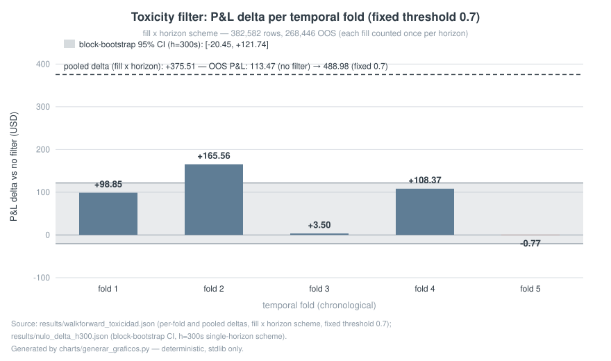
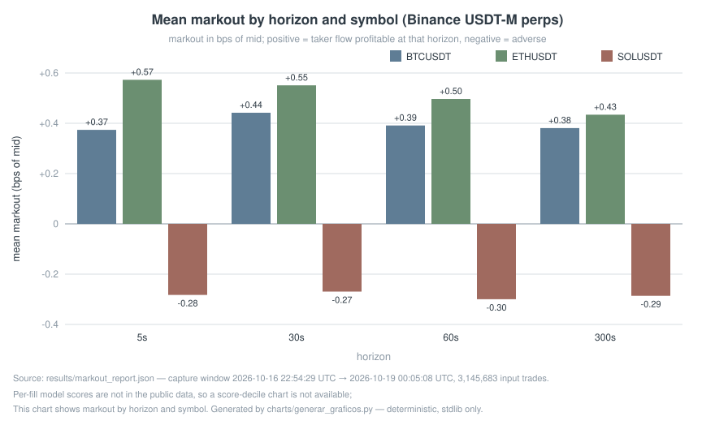

# Market Microstructure: 24/7 Capture Pipeline + Honest Fill-Toxicity Model

> **EN** | [ES](README.es.md)

[](https://github.com/RuarteGustavoAndres/market-microstructure-portfolio/actions/workflows/ci.yml)

A 24/7 market-microstructure pipeline (Polymarket CLOB + Binance USDT-M
perpetuals): multi-venue WebSocket order-book capture into TimescaleDB, plus a
leak-free machine-learning model that predicts **fill toxicity (adverse
selection)** from order-book features. Every number here is real,
out-of-sample — **including the parts that did not work**. Dense per-row
validation detail lives in [RESULTS.md](docs/RESULTS.md); the READMEs are an
index + headlines.

**Three results, with their caveats**

1. **159M+ order-book events and 958k+ real fills** captured 24/7 into
   TimescaleDB (15,161+ markets tracked, 237 active tokens in the last 7 days).
   Live status, machine-generated daily:
   [`results/CAPTURE_STATUS.md`](results/CAPTURE_STATUS.md).
2. **Toxicity classifier: AUC 0.7276 pooled OOS, out-of-time walk-forward
   (leak-free); PR-AUC 0.4963 vs 0.304 prevalence** — pooled over the
   fill×horizon scheme (382,582 rows); the by-market scheme scores 0.7356
   (see docs/RESULTS.md, "AUC provenance"). Caveat: it *ranks*
   toxicity — it is a scoring/filter layer, **not** a decision-maker. The
   AUC is the ranking answer; the economic answer is item 3 — the P&L
   delta with its market-block CI, **not** the AUC.
3. **Walk-forward verdict (h=300s): the filter's P&L delta over unfiltered is
   +$99.24 GROSS** (CPU reference run — the null-test artifact's own GPU
   re-run reports +98.23; the random-filter null rejection at 5%, the
   block-bootstrap CI **[−$20.45, +$121.74]** and the p95 +45.27 all come
   from that GPU re-run, whose per-fold deltas are within ~1% of the CPU
   reference). Caveat: the block-bootstrap CI includes 0, the absolute level
   @0.7 is still negative (−$7.51), and queue simulation + costs are pending —
   **the gate stays closed.** Full detail below (tables + JSONs).

## Verdict at a glance

| Claim | Verdict | Evidence |
|---|---|---|
| The model ranks fill toxicity out-of-sample without leakage (AUC 0.7276 fill×horizon; 0.7356 by market) | ✅ **WORKS** | [walkforward_toxicidad.json](results/walkforward_toxicidad.json) · [folds_mercado_toxicidad.json](results/folds_mercado_toxicidad.json) · row *The model* |
| The filter's P&L delta over unfiltered is positive and rejects the random-filter null at 5% (+$99.24 GROSS) | ✅ **WORKS** — caveat: CI [−$20.45, +$121.74] includes 0 | [nulo_delta_h300.json](results/nulo_delta_h300.json) · row *Null test of the delta* |
| The filter makes money in absolute terms / is trade-ready | ❌ **DOESN'T WORK** — level @0.7 negative (−$7.51), WFE −0.8%, thresholds unstable | [walkforward_toxicidad_h300.json](results/walkforward_toxicidad_h300.json) · row *P&L maker walk-forward* |
| A maker-realistic queue sim (persistent quotes) confirms the delta persists | ⚠️ **WORKS (direction only)** — delta +$9.26, both folds; AUC ≈ 0.56 | [walkforward_toxicidad_h300_persist.json](results/walkforward_toxicidad_h300_persist.json) · row *Queue sim, persist mode* |
| Live trading gate (queue + costs + size) | ⏳ **PENDING** — gate stays closed | [PLAN_SIM_COLA.md](docs/PLAN_SIM_COLA.md) · rows *The model* / *Next steps* |

**Charts** — generated by [`charts/generar_graficos.py`](charts/generar_graficos.py)
(deterministic, stdlib only: two runs produce byte-identical SVGs):


*Delta per fold of the toxicity filter (fill x horizon scheme, fixed threshold 0.7), with the block-bootstrap 95% CI of the h=300s scheme for reference.*


*Mean markout (bps of mid) by horizon and symbol — per-fill model scores are not in the public data, so this is the honest stand-in for a score-decile chart.*

## Service: backtest audit

We audit quantitative trading backtests for the failure modes that survive
casual review: look-ahead bias, free fills, in-sample tuning, survivorship,
scale-dependence. **What you get:** a written verdict per finding with the
exact mechanism, a machine-readable JSON per check, and a reproducible
stdlib-only harness you can run yourself. The audit method audits itself
(see *The auditor audited* below: 8,000 edge-free null strategies across 8
types, planted
look-ahead traps, known detector limitations documented with a dedicated
study). Scope and turnaround: fixed price $250–500 per backtest, delivered in 5
business days — one-page example of the method applied to this very pipeline:
[CASE_STUDY.md](CASE_STUDY.md). Contact: open a GitHub issue on the
market-microstructure-portfolio repo.

`demo/` and the charts run **standalone** (stdlib only); `tests/` additionally need pytest — nothing beyond that.

## Run the demo (stdlib only, dependency-free)

```bash
python3 demo/audit_demo.py
```

## Highlights
- **159M+ order-book events** (libro_eventos) + **958k+ fills** (trades_full)
  captured 24/7 into TimescaleDB hypertables — **15,161+ markets tracked**
  (verified 2026-10-24, results/CAPTURE_STATUS.md).
- **Hundreds of thousands of order-book events per hour, sustained 24/7**, into
  a TimescaleDB hypertable (compression + retention policies).
- **Toxicity classifier: LightGBM AUC 0.7276 pooled OOS (out-of-time,
  leak-free, fill×horizon scheme; by-market 0.7356)**, per-fold range **0.689-0.786** — rows are fill×horizon pairs
  (each fill appears once per horizon), so every P&L table sums each fill 4×.
  The pooled/per-market gap is a difference in base rates, and we declare it.
- Caught and removed **feature-leakage traps** (incoming-trade size, stale snapshots, horizon pooling) that had inflated AUC from 0.736 to 0.765.
- Grounded in the microstructure literature: OFI (Cont 2014), micro-price
  (Stoikov 2018), markout, Glosten-Milgrom / Kyle.
- **Backtest Audit Demo** — a runnable, dependency-free teardown
  ([`demo/audit_demo.py`](demo/audit_demo.py), results in
  [`results/AUDIT_DEMO.md`](results/AUDIT_DEMO.md)): a synthetic backtest with
  planted look-ahead, free fills and in-sample tuning reports Sharpe 98.33; forced
  to obey reality (tradeable information, book-priced fills, walk-forward
  tuning) it loses exactly the spread. Five audit checks, self-verifying.
- **Venue 2 live: Binance USDT-M perpetuals** (2026-10-16) — same pipeline,
  second asset class: aggTrades with aggressor side + top-5 book + funding for
  BTC/ETH/SOL perps, 24/7 systemd capture. Markout / adverse-selection
  analytics in [`analytics/adverse_selection.py`](analytics/adverse_selection.py).

### Data status (declared, as of 2026-10-22)
- Continuous capture **2026-10-14 → present** (trades stream: no gaps).
- **Known outage:** order-book stream down **2026-10-15 ~17:00–20:00 UTC** (~3h,
  systemd services were not `enabled` and died with an interactive session;
  fixed — all capture services are now `systemctl --user enable`-ed with
  linger).
- Any analysis spanning that window must exclude or flag it. We say so because
  an honest dataset declares its holes.
- **Live status:** [`results/CAPTURE_STATUS.md`](results/CAPTURE_STATUS.md) —
  machine-generated daily from the production database, so what you read is
  always <24h old.

## Architecture
```
WebSocket (market channel, per venue)
   │  asyncio producer → queue → consumer  (network never blocks on processing)
   ▼
In-memory order book per instrument (snapshot + incremental diffs)
   │  micro-batch flush: 500 rows / 2s
   ▼
TimescaleDB hypertables (libro_eventos, trades_full, libro_top5, market_meta
                          + binance_* tables for venue 2)
   │  feature engineering (OFI, microprice_bias, momentum, ...)
   ▼
Fill-toxicity classifier (LightGBM)  →  AUC 0.7276 pooled OOS, out-of-time (leak-free; fill×horizon scheme; by-market 0.7356)
```

## Pipeline modules
| Module | Purpose | Runs on |
|---|---|---|
| `microstructure/capture/http.py` | ISP-fault-tolerant HTTP + pinned-IP DNS fallback (selective NXDOMAIN resilience) | repo only (library) |
| `microstructure/data/tsdb.py` | TimescaleDB connection + micro-batch flush helpers | private TimescaleDB |
| `microstructure/model/features_ml.py` | Feature engineering: OFI, micro-price, multi-horizon momentum, markout labels | private capture DB (input) |
| `microstructure/model/entrenar_toxicidad.py` | Classifier training: GroupKFold by market, per-market z-score, leakage-safe features | private dataset (gitignored) |
| `microstructure/model/backtest_walkforward.py` | Walk-forward backtest of the toxicity filter: temporal splits, 300s embargo, exact fill P&L — published verbatim from the private bot | private dataset (gitignored) |
| `microstructure/model/backtest_desglose.py` | OOS P&L breakdown of the walk-forward verdict: by horizon, side, fill aggressiveness, spread + maker-realistic adjustment | private dataset (gitignored) |
| `microstructure/sim/sim_cola.py` + `microstructure/sim/sim_maker_dataset.py` | Queue-fill simulation over the REAL capture with three comparable requote modes (**persist** = honest, no auto-cancel / **cancel** = status quo / **contra** = conservative) + its dataset builder — published verbatim from the private bot | private capture DB (fills CSV shipped) |
| `microstructure/model/backtest_walkforward_persist.py` | The same walk-forward (documented adaptations only) run on the persist-mode simulated fills — `results/maker_fills_sim_persist.csv` (1.1 MB, included) → `results/walkforward_toxicidad_h300_persist.json`, fully reproducible | **standalone** — ships with the repo (copy the shipped CSV into `microstructure/model/dataset/`) |
| `microstructure/model/backtest_nulo_delta.py` | Null test of the filter's delta: random-filter null (same per-fold retention) + market-block bootstrap + permuted-label control — published verbatim from the private bot | private dataset (gitignored) |
| [VALIDATION_WINDOW.md](docs/VALIDATION_WINDOW.md) | Pre-registered reserved validation window: freeze 2026-10-25, single evaluation 2026-11-08, decision rule fixed in advance (same rule as the 2026-10-23 null test) | **standalone** — documentation, no data needed |

## The model (honest numbers)
- **Target:** markout of each real trade at +horizon (book mid vs fill price).
  Markout < 0 = adversely selected.
- **Multi-horizon labeling:** every fill labeled at 1s/10s/60s/300s. The
  freshness-capped walk-forward dataset is **382,582 fill×horizon rows**
  (268,446 of them out-of-sample, across **224 distinct fills**; each fill
  contributes one row per horizon — these are fill×horizon *pairs*).
- **Validation:** GroupKFold by market (unseen-market generalization) +
  per-market z-score normalization.
- **Leakage removed:** `pos_en_spread` and `fill_price` reconstruct the target
  by construction — dropped them, AUC fell from 0.702 to the honest 0.6425
  (MLP baseline).
- **Leak-free re-run:** pooled AUC **0.7356** out-of-fold on unseen markets
  (GroupKFold by market; freshness-capped snapshots, causal standardization) —
  `results/folds_mercado_toxicidad.json`. Same leak-free pipeline as the
  temporal fill×horizon headline (AUC 0.7276): different validation scheme,
  not a contradiction — see docs/RESULTS.md, "AUC provenance".
- **Honest limitations:** the model ranks toxicity (AUC) but binary accuracy
  sits below the majority baseline → it is a scoring/filter layer, not an
  autonomous decision-maker. Under exact-markout single-horizon walk-forward
  (h=300s, 2026-10-22) the delta is **positive and rejects the random-filter
   null at 5%** (null test 2026-10-23 — row below; the block-bootstrap CI is
   wide and includes 0, both reported) — a **+$99.24** GROSS P&L delta over
   unfiltered under tape-fill assumptions —
  but the absolute level @0.7 is **negative** (−$7.51 over 80,379 ops;
  unfiltered −$106.75), per-op walk-forward efficiency is **−0.8%** (below the
  30% overfitting-warning line), thresholds per fold are not stable, and a
  first queue-aware simulation (T2/T3, 2026-10-18) was **inconclusive**: the
  model's AUC on simulated fills is ~0.50-0.56 (approximated features,
  out-of-distribution), so the tape-based numbers assume ideal fills
  ([PLAN_SIM_COLA.md](docs/PLAN_SIM_COLA.md)). **Queue sim re-run with assumption 3
  corrected** (persistent quotes — the old optimistic auto-cancel removed
  exactly the adverse fills a real maker eats; sim engine published verbatim
  in `microstructure/sim/`): the filter's delta over unfiltered is **+$9.26**
  GROSS (unfiltered −$15.57 → filtered @0.7 −$6.31; 2 of 3 temporal folds (fold 2 dropped by the embargo),
  1,580 fills, one fill = one sample, h=300s), **positive in both folds** —
  the old T2/T3 negative delta (−$682) was an artifact of that auto-cancel
  assumption. AUC on the sim stays near chance (pooled 0.556, folds
  0.533–0.599; features approximated by design) and the sample is ~80×
  smaller than the real dataset, so this reads as DIRECTION, not magnitude —
  the gate stays closed. The previous +$489 @0.7 level came
  from the 382,582-row scheme that summed all four horizons of every fill
  (fill×horizon pairs) — a previous 4×-counted estimate; the current scheme
  counts one fill once. The gate stays closed.

| Metric | Value |
|---|---|
| AUC-ROC pooled OOS (LightGBM, out-of-time, leak-free, fill×horizon scheme) | **0.7276** |
| PR-AUC OOS / prevalence | **0.4963 / 0.304** |
| AUC per temporal fold (range, 5 folds, h=300s) | **0.653 / 0.787** |
| Walk-forward rows (single horizon h=300s, 2026-10-22 refresh) | 129,175 total; 80,379 OOS ops at fixed 0.7 |
| **Walk-forward OOS maker P&L (single horizon h=300s, 2026-10-22 refresh, 129,175 rows — GROSS, tape-fill assumptions; queue+costs pending)** | **DELTA-POSITIVE, LEVEL-NEGATIVE, still fragile** — exact-markout, temporal splits, 300s embargo, one fill = one sample: unfiltered **−106.75 USD** · filter @0.7 **−7.51** (80,379 ops) · **delta over unfiltered +99.24** · per-fold-optimal thresholds 0.6/0.5/0.7/0.6/0.55 (**not stable**) → fixed 0.7 filter. WFE **−0.8% per op** (OOS vs in-sample P&L per op; below the 30% overfitting-warning line). Previous 4×-counted estimate (382,582-row scheme, all four horizons per fill): +488.98 @0.7. Gate stays closed pending queue simulation + costs; numbers reported anyway. |
| **Per-horizon walk-forward (one fill = one sample per horizon, fixed 0.7, GROSS tape-fill assumptions, re-runs 2026-10-23)** | delta is positive at **all four** horizons and grows with the horizon — h=1s: **+18.49** (fold AUC 0.637–0.740) · h=10s: **+56.60** (0.682–0.756) · h=60s: **+89.27** (0.666–0.774) · h=300s: **+99.24** (0.653–0.787). The unfiltered LEVEL flips sign with horizon (+77.84 / +101.32 / +40.62 / −106.75) — adverse selection grows with horizon; the delta is the stable quantity. The pooled **AUC 0.7276** above comes from the fill×horizon scheme (382,582 rows); the per-horizon fold AUCs are the ranges in this row (deltas now null-tested — rows below). **These four horizons come from the same fills — the deltas are correlated, not four independent confirmations.** The headline h=300s was fixed **a priori** by the 2026-10-23 decision rule (row below); the other horizons are secondary. JSONs: `results/walkforward_toxicidad_h{1,10,60,300}.json`. |
| **Null test of the delta (decision rule fixed a priori on 2026-10-23, before running: single horizon h=300s, threshold 0.7, statistic = delta; reject at 5% if pooled delta ≥ p95 of a random-filter null AND delta > 0 in ≥4/5 folds)** | **REJECTED at 5%.** Observed pooled delta **+98.23** (GPU re-run; CPU reference +99.24) vs random-filter null (same per-fold retention, 1,000 fixed-seed draws) p95 **+45.27** — the observed delta sits above the null's 100th percentile (p99 +52.01, max +61.02), and is > 0 in **4/5 folds**. Control: 50 re-trainings with labels permuted within market → delta **−1.10 ± 10.21** (min −22.23, max +19.09): the pipeline does not manufacture signal. Secondary (threshold re-drawn per draw): observed delta at p98.9 of that null. **Honest caveat:** the market-block bootstrap CI of the delta, **[−20.45, +121.74], includes 0** (high sampling volatility; 2 of 5 folds nearly zero) — both results are reported. Gate stays closed (level negative, WFE negative, queue+costs pending). Code and JSON: `microstructure/model/backtest_nulo_delta.py`, `results/nulo_delta_h300.json`. |
| **The auditor audited: Monte Carlo of the 5 leak detectors (2026-10-27, alpha=0.01, 999 permutations/test, Wilson 95% CIs)** | Over **8,000 edge-free null strategies** (8 types × 1,000 seeds, 90-day markets, spread 2×40 bps): **false-positive rate per detector — capturabilidad 0.00%, fills-at-book 0.00%, tuning-in-sample 0.06% (5/8,000) [CI 0.03, 0.15], kfold-cv 0.86% (69/8,000) [CI 0.68, 1.09], survivorship 1.50% (120/8,000) [CI 1.26, 1.79]; union 2.39% (191/8,000) [CI 2.08, 2.75]** — every detector ≤ 10%. **Power: 100% (union) on all three look-ahead traps** (full look-ahead caught by tuning/kfold/survivorship — survivorship alone 83/100; 1-bar look-ahead by all five; 50% partial look-ahead: capturabilidad 86%). **Nulls added 2026-10-25:** mechanical stop-loss exit (declared → the survivorship check SKIPS it by design) union FP 0.90% [CI 0.47, 1.70]; asymmetric payoffs with a fat right tail, NOT declared (nothing is filtered out) union FP 5.50% [CI 4.25, 7.09] — almost all of it the survivorship detector (4.90% [CI 3.73, 6.42]): an honest mechanical-payoff FP, still under the 10% budget; small real fast alpha (edge = 10% of half-spread): 0.00% [CI 0.00, 0.38] — it produces ~1 trade per run, consistent with the tiny-edge trap. **Null added 2026-10-27 (specificity control):** an honest strategy with a small positive edge *net of declared costs* (mean +4.5 bps per trade, half-spread 4.5 bps, fills declared net) and **≥200 trades enforced (observed min 2,808, median 3,645)**: flagged **7.2% (72/1,000) [CI 5.8, 9.0]** — under the 10% FP budget but above the 5% nominal, almost all from the temporal kfold-CV check reacting to a real (small) edge; documented as a known limitation, not a plumbing failure. Net: a ~1-trade tiny edge is flagged 0% of the time, while a real small net-positive edge with 200+ trades is flagged 7.2% — the detectors catch plumbing, and separating a real small edge from noise takes more history than 5 CV blocks provide. Known limitation: capturabilidad cannot see a full-hold look-ahead (a 1-bar delay removes only 1/30 of the peek); the other four detectors cover it. ~105 min wall on 6 CPU cores. JSON: `results/monte_carlo_fp_power.json`. |
| **The auditor audited itself: five synthetic controls × two price scales (2026-10-23, 3 honest + 2 look-ahead traps, p0=0.5 vs p0=100; all five are synthetic — written by us for this audit, no third-party code)** | **Scale invariance restored and verified**: the harness now scales the round-trip cost with the market scale (constant 80 bps: `half_spread = HALF_SPREAD * p0 / P0`), and the audit rng is seeded identically per strategy across scales — 5/5 strategies return **identical verdicts at both scales**, pnl ratio exactly 200.0×. Verdicts: the 2 look-ahead traps FAIL/WARN in both scales (tuning-in-sample, kfold, fills-at-book all fire); the 3 honest strategies PASS — including `spread_sniper` since the **2026-10-24 forensic audit**: the old survivorship flag (7/24 honest runs = 29.2% at both scales) was **NOT a fixed-cost artifact** — pnl_net = pnl_gross − 2·half_spread is a pure translation and the rank-based tail test is shift-invariant ((nl, nr, p) identical net vs gross in 48/48 runs; identical 7/24 FP at 200× relative cost). The real root cause was **broken sample independence**: level-selective clients enter in bursts — one price excursion spawns a run of entries whose hold windows share the same realized path — so the binomial treated 9.7k–54k reported rows as independent draws (worst seed: one cluster held 61% of trades). Check 5 now runs the tail test on **non-overlapping trades** (same units as the honest Sharpe; <200 units → SKIP): **0/24 flagged at both scales, absolute and relative pnl**; the Monte Carlo survivorship FP dropped 5.0% → 1.19% (supervivencia [0.96%, 1.47%] Wilson) with trap power preserved (83–100/100). The resolved diagnosis is recorded in the JSON (`limitaciones_conocidas`); study script + JSON: `demo/estudio_limitacion_supervivencia.py`, `results/estudio_limitacion_supervivencia.json`. The false edge previously reported for `momentum_chaser` at p0=100 (mean +0.086/trade) came from an additive spread over lognormal prices — the cost-scaling fix removes it. |
| **Maker-realistic queue sim, persist mode (walk-forward on simulated persistent-quote fills, 2026-10-23)** | The closest test to a real maker: queue-position fills with **persistent quotes (no auto-cancel)** — the assumption whose removal caused the old −$682 artifact; sim engine published verbatim in `microstructure/sim/`. On 1,580 simulated fills (one fill = one sample, h=300s, 2 temporal folds): unfiltered **−$15.57** → filter @0.7 **−$6.31**, **delta +$9.26, positive in both folds**; pooled OOS AUC **0.5563** (folds 0.533–0.599 — features approximated by design, out-of-distribution); per-op WFE **−33%** (totals −19.6%). The sample is ~80× smaller than the real dataset → reads as **DIRECTION, not magnitude**; the gate stays closed. JSON: `results/walkforward_toxicidad_h300_persist.json`. |

## Venue 2 — Binance USDT-M perpetuals (live since 2026-10-16)
Second venue feeding the same TimescaleDB stack, same order-book sync protocol
(snapshot + diff with update-id chain verification, gap detection, resync —
the official Binance algorithm): aggTrades with aggressor side, top-5 book at
2s cadence, and funding/mark-price every 5 minutes for BTCUSDT/ETHUSDT/SOLUSDT.
Captured 24/7 by a systemd service (public streams, no account involved).
Event→ingest latency ~0.3s. Execution-quality analytics (pure functions,
tested): [`analytics/adverse_selection.py`](analytics/adverse_selection.py) —
markout at multiple horizons, no look-ahead (the mid used is the last one
known at or before t+h; trades whose horizon passes the last quote are
excluded, never extrapolated).

Venue 1 (Polymarket CLOB, above) = discrete-event prediction markets; this
venue 2 = continuous high-frequency books — same schema, same analytics.

### Markout in bps of mid (2026-10-16 22:54 → 2026-10-19 00:05 UTC, 3,145,683 aggressive trades)

| Symbol | mean bps @5s | median bps @5s | toxic frac @5s | mean bps @300s |
|---|---|---|---|---|
| **BTCUSDT** | +0.37 | +0.09 | 46% | +0.38 |
| **ETHUSDT** | +0.57 | +0.27 | 43% | +0.43 |
| **SOLUSDT** | **−0.28** | **−0.48** | **68%** | −0.29 |

**How to read this (and what NOT to claim):** markout of the mid measures
adverse selection of *aggressive* flow — a maker filling the other side earns
the negative of it. BTC/ETH show small positive markout (their aggressors are
right at 5s), SOL is clearly toxic (median −0.48 bps, 66–68% of taker trades
lose). **On the entry term:** BTC's entry −0.44 bps (~$3.6 on ~$81k) is far
above the one-tick quoted spread, and an entry-staleness stratification
([`results/markout_entry_staleness_probe.json`](results/markout_entry_staleness_probe.json),
read-only probe over the full capture table, ~11.5 days) shows it does
**not** shrink with fresher mids: entry stays ≈−0.5 bps for entry mids
younger than 2s (~90% of trades: 0–0.5s −0.52, 1–2s −0.53) and only
degrades for mids ≥2s old (2–5s: −0.87). **Origin of the entry floor: a fixed
trade-vs-snapshot timestamp lag; no permanent negative floor survives beyond
~1 s.** A timestamp-offset sweep
([`results/markout_entry_lag_probe.json`](results/markout_entry_lag_probe.json),
script
[`microstructure/scripts/markout_entry_lag_probe.py`](microstructure/scripts/markout_entry_lag_probe.py),
read-only, 2026-10-21→10-28 window, δ ∈ {−0.5 … +2 s}) recomputes the entry
with the mid lookup shifted by δ: entry(δ) is *not* flat — the median
collapses monotonically to its static quoted half-spread by δ≈+0.5…+1 s (BTC
−0.280 → −0.006 at +0.5 s → −0.006 at +1 s; ETH −0.368 → −0.062 → −0.021; SOL
flat at −0.491 ≡ its half-spread 0.490 at every δ) and turns **positive** at
δ=+2 s (BTC median +0.080 / mean +0.228; ETH +0.153 / +0.294) as the mid
drifts with the trend. The mean decays slower than the median (BTC −0.591 →
−0.244 at +0.5 s → −0.090 at +1 s) because of a heavy tail; it crosses zero
only between +1 s and +2 s, and the mean identifies nothing on its own — at
positive δ the shifted mid lookup mixes the lag correction with real drift in
the aggressor's favor (the toxicity signal itself), so only the median
plateau localizes the offset, and a residual mean of ≈−0.09 bps at +1 s stays
unexplained by the lag alone. The minimum is enclosed, and the mean tail at
+0.5 s is transient mid movement, not a permanent floor. Consistent with a fixed
ingest-timestamp offset of order ≤0.5 s between the aggTrade and
book-snapshot stamps (the two probes constrain different clocks: staleness =
freshness within the book's own timeline; offset = cross-stream alignment).
**Consequence for the toxicity readout: the drift/entry decomposition inherits
the same mid(t) — the drift term is also looked up against the (possibly
lagged) mid — so neither term should be cited as an independent impact
measure, and the table above should be re-derived on the clean raw measure
(fill-to-fill: exit fill price − entry fill price, no mid) before being used
as an absolute cost/impact number.** **Do not read this as "the taker pays
the spread twice", as an execution-quality claim, or as an established impact
figure** — short-horizon numbers are floor-noisy, not a cost model.

**Robustness — raw trade-to-trade markout (no mid, no book):**
[`results/markout_trade_to_trade.json`](results/markout_trade_to_trade.json)
([`microstructure/scripts/markout_trade_to_trade_probe.py`](microstructure/scripts/markout_trade_to_trade_probe.py),
read-only, same 2026-10-21→10-28 window) recomputes the exit markout entirely
inside the aggTrade stream: raw(h) = 1e4·sign·(p_trade(t+h) − p_trade(t)) /
p_trade(t), with p_trade(t+h) the first trade at or after t+h — no mid
lookup, no book snapshot, hence no cross-stream clock to misalign. It does
**not** reproduce the negative short-horizon markout of the snapshot-based
probes: medians are positive and grow with h (BTC +0.17 @0.5 s → +0.24 @2 s →
+0.39 @300 s; ETH +0.26 → +0.34 → +0.38), nearly identically for both
aggressor sides — aggressive trades are followed by continued motion in their
direction, not reversion. SOL's median is ≈0 at every horizon: with a
half-spread ≈0.49 bps and a 1-tick price grid the measure is
bounce/tick-dominated there and must be read with care. This measure has its
own convention contamination (exits are future taker prints, entries pay the
spread), so it is a cross-check, not a cost model; its role is to bound the
lag artifact: the lag-free measure shows no negative short-horizon floor for
BTC/ETH, which limits how much of the snapshot-based negativity can be real
adverse-selection cost rather than alignment/convention artifact. All figures
descriptive only.

**Robustness — strict freshness cap (0.5s):** re-running with
`--max-mid-age 0.5` (drops ~78% of fills, median exit-mid staleness
0.25s), only fresh exit mids;
[`results/markout_strict_freshness.json`](results/markout_strict_freshness.json)
keeps the same shape: BTC +0.38, ETH +0.50, SOL −0.26 mean bps @5s (drift
~+0.81/+1.08/+0.31, entry ~−0.43/−0.58/−0.58). A further cap at 1s
([`results/markout_max_mid_age_1s.json`](results/markout_max_mid_age_1s.json))
moves BTC drift to 0.77 @5s / 0.84 @300s and entry to −0.40 @5s — the
decomposition shifts only modestly with the freshness cap. The per-market ordering and
signs are stable; the entry/drift decomposition itself is **not** quoted as a
cost model — the drift term barely scales with horizon (0.81 @5s → 0.68
@300s), so "market drift" vs "mid-offset" cannot be separated with this data
and the decomposition was removed from the headline reading.

Regenerate with `microstructure/scripts/markout_binance.py` (read-only, live
DB; latest machine-readable report in
[`results/markout_report.json`](results/markout_report.json)).

## Next steps (scoped)
- ~~MLP → LightGBM~~ **done** — superseded by the leak-free LightGBM re-run (AUC 0.7356 by-market / 0.7276 fill×horizon, both leak-free).
- ~~Backtest the toxicity filter against P&L under tape-fill assumptions~~ **done on leak-free features
  (freshness-capped snapshots, causal standardization, temporal folds) —
  under the strict single-horizon walk-forward (h=300s, one fill = one
  sample, 300s embargo) the delta is positive (random-filter null rejected
  at 5%; block-bootstrap CI wide, includes 0 — both reported):
  **+$99.24 GROSS P&L delta over unfiltered** (level @0.7: −$7.51; gross,
  tape-fill assumptions; 2026-10-22 refresh, 129,175 rows). The earlier
  4×-counted scheme (fill×horizon pairs, 382,582 rows) had shown a +$376
  delta / +$489 level — same qualitative story, inflated level. WFE per op
  is **−0.8%** and per-fold optimal thresholds remain **not stable**
  (0.6/0.5/0.7/0.6/0.55); queue simulation (docs/PLAN_SIM_COLA.md) is still
  pending — the gate stays closed.** AUC ranks flow; converting it into
  profitable maker P&L (queue position, rewards, fees) remains open work.
- Investigate why ranking skill does not translate fully: per-horizon/per-regime
  P&L, queue-position-aware simulation, cost model calibration.
- **Reserved validation window (pre-registered 2026-10-25):** single evaluation
  on fresh data on **2026-11-08**, under the exact decision rule pre-registered
  on 2026-10-23 (h=300s, fixed threshold 0.7, pooled delta vs random-filter
  null p95, delta > 0 in ≥4/5 folds); the result is published unconditionally —
  see [VALIDATION_WINDOW.md](docs/VALIDATION_WINDOW.md).

## License
MIT — see [LICENSE](LICENSE). Use freely, attribution appreciated.

## Author
Gustavo Ruarte — market microstructure & ML engineering.
Contact: open a GitHub issue on the market-microstructure-portfolio repo.
